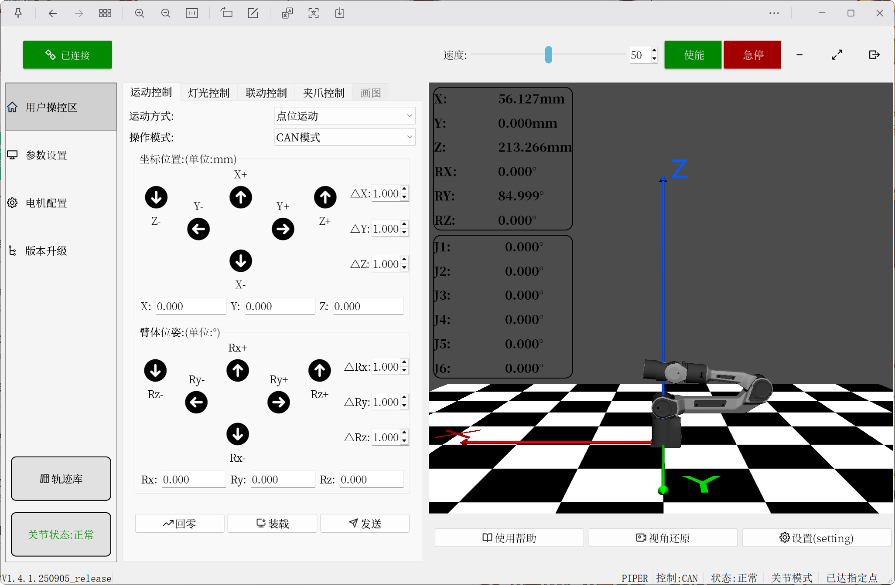

# Piper使用指南

> 20261122

## 启动事项

1. 重启go记得关闭夹爪！！！

2. 在插拔can线后

   ```bash
   sudo ip link set can0 type can bitrate 1000000 && sudo ip link set can0 up
   # 输出RTNETLINK answers: Device or resource busy或无输出
   ```

   成功后检查：

   ```
   ip -details link show can0
   ```

   预期包含 **UP、bitrate 1000000、ERROR-ACTIVE**

### 查看当前角度等

查看piper各关节和夹爪状态以及进行控制都需要两个终端A和B，B终端用于查看状态，也可用于诊断

控制电脑 Bash 终端 A：

```bash
cd /home/isee-pst/unitree_ros2/piper
bash piper_go2.sh inspect
```

另开 Bash 终端 B，保持诊断运行：

```bash
cd /home/isee-pst/unitree_ros2/piper
bash piper_go2.sh diagnostics
```


出现 OBSERVING 后，查看以下字段：

| 字段 | 含义 |
|---|---|
| joints_deg | J1～J6 当前角度，单位 ° |
| joints_enabled | 六个关节的使能情况，true 为已使能 |
| gripper_width_mm | 夹爪反馈开口，单位 mm |
| gripper_enabled | 夹爪是否使能 |
| gripper_torque_nm | 夹爪反馈力矩，单位 N·m |
| ctrl_mode | 当前控制模式 |
| arm_status、err_code | 机械臂状态与错误码 |
| motion_status | 运动状态 |
| missing_feedback | 缺失或不新鲜的反馈；正常应为 [] |

若显示 WAIT_IO 或 WAIT_FEEDBACK，根据同条日志中的原因排查；字段为 null 表示当前没有有效反馈，不能当成零值。

### 回零脚本用法：（go上位机）

```bash
cd /home/unitree/piper-zero-20261119
export PIPER_VISION_GRASP_PYTHON=/home/unitree/piper-handeye-20261112/.handeye-venv/bin/python
bash scripts/piper_return_zero.sh --help
# 退出0且动作列表包含 `zero`然后执行回零
bash scripts/piper_return_zero.sh
```

### 使用SDK返回CAN模式：(退出视教返回给代码控制)

```python
手动切换时，先退出抓取等控制程序，然后在 Go2 终端中执行（目录不限）：

/home/unitree/piper-handeye-20261112/.handeye-venv/bin/python

进入 >>> 提示符后，先初始化连接：

import time
from piper_sdk import C_PiperInterface_V2

piper = C_PiperInterface_V2("can0")
piper.ConnectPort(can_init=True, piper_init=False, start_thread=True)
time.sleep(0.3)

# piper.MotionCtrl_1(grag_teach_ctrl=0x02)  # 结束记录，退出拖动示教
time.sleep(0.2)
piper.MotionCtrl_1(grag_teach_ctrl=0x00)
piper.MotionCtrl_2(1, 1, 20, 0)
# CAN控制、关节模式、20%速度

切换后检查：

time.sleep(0.3)
s = piper.GetArmStatus().arm_status
print(s.ctrl_mode, s.teach_status)  # 应为 1 0

操作完成后执行 
piper.DisconnectPort()
exit()

如果上面那个输出已经是1 0就不用执行下面的了
```

```bash
# 恢复收帧在go上位机
bash ~/.local/state/piper-vision-grasp/fit25-j56-live-tools/restore-can.sh
看到 can0 UP 并出现 2A1\#… 即表示恢复
```

## 机械臂调零（很关键，仔细阅读）



这个软件有问题，当摆好设零姿势后，在电机配置里面让全部关节 零点确认后得到的值与教程视频的值<span style="color:red">不同</span>， 导致此处回零不能得到预期的结果。因此**<span style="color:red">逐个</span>关节设置零点**，使得<span style="color:blue">调零点处</span>关节角值为[0.107,-1.956,2.219,0.000,19.422,0.000],此时我们的机械臂<span style="color:blue">采集的数据</span>为全0。 由此，后续所有姿势的关节角**加上这行值**重新计算FK。

即
$$
实际关节角= 传感器值+[0.107,-1.956,2.219,0.000,19.422,0.000]
$$
建议以后回零都指回到传感器的零点，因为机械臂搭着最省电。
