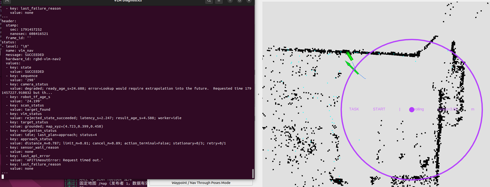
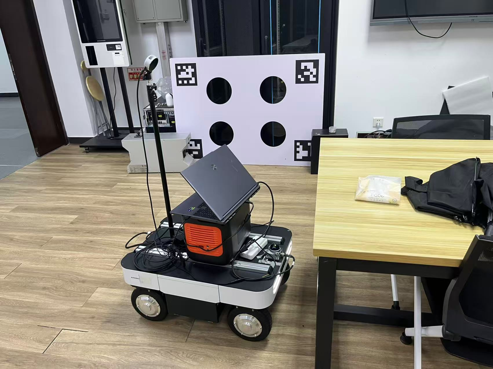
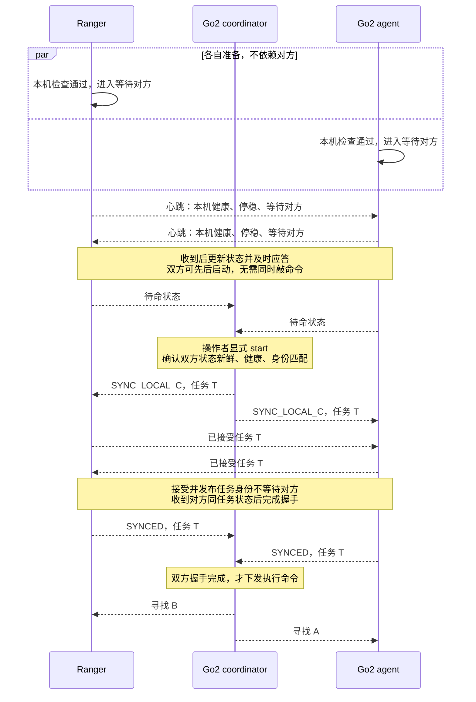
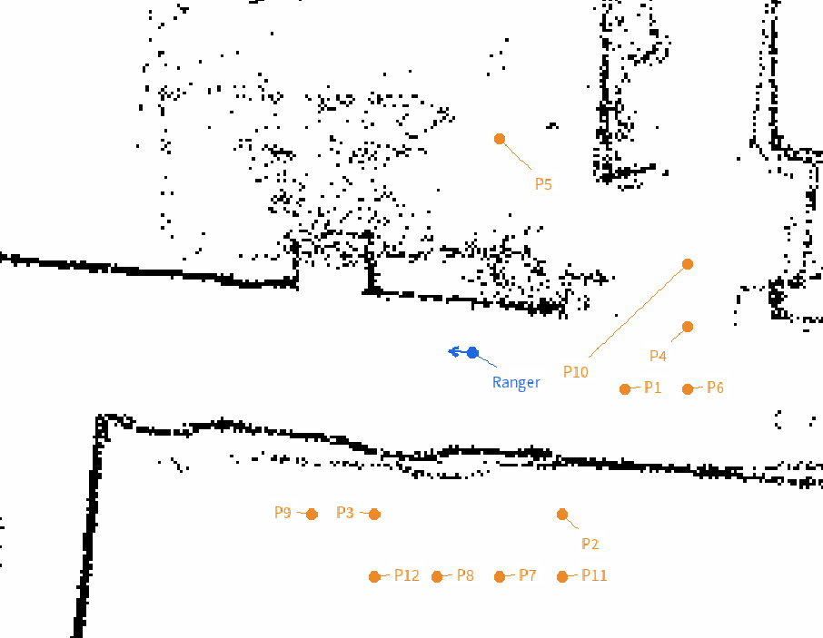
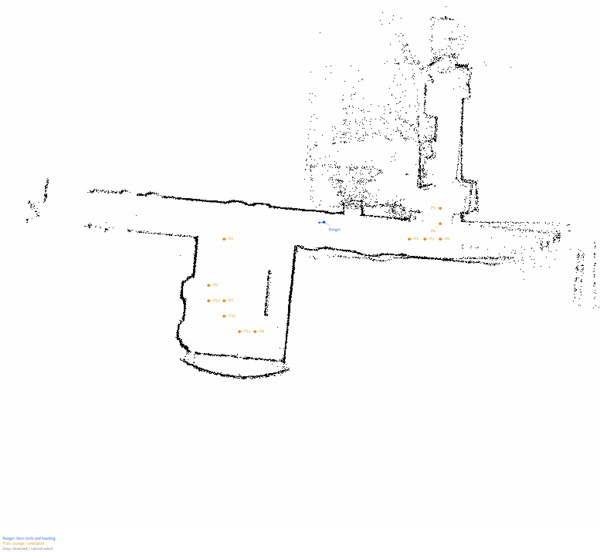
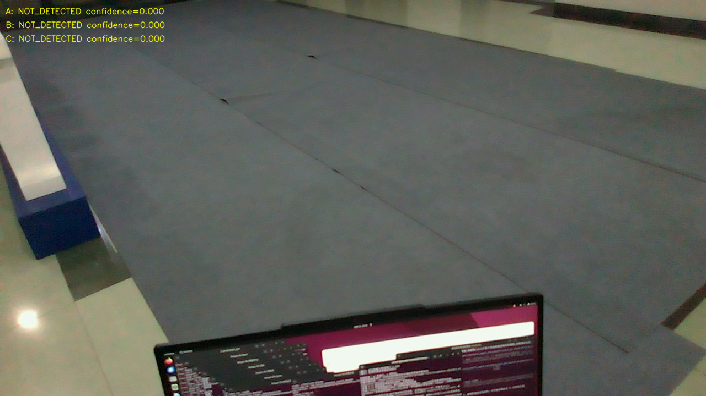
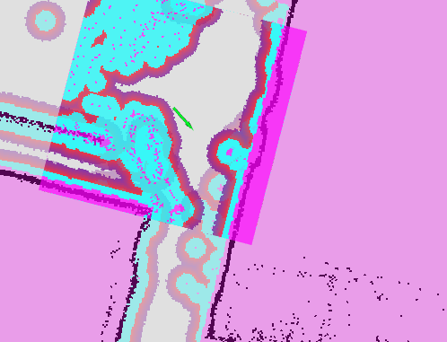

# 10.08

今天完成数据迁移, 验证完硬件相机,雷达,小车底盘能正常驱动,VLM换模型后请求延迟也合适.

安装了typora, 输入法, 发现cdh的windows电脑通过todesk映射到这台linux时非常诡异,每按一个键numslock都会闪烁,而输入字符正常,只是无法设置和使用快捷键:设置时所有键都被认成了numslock,且无法用这些键来切换中英文了. 而且因为这个神秘bug, 无法持续按backspace来删除, 变得很不便利. 不知道什么罕见bug

正在验证VLM_Nav的时候出现怪异之事:当FASTLIO没有报丢帧时,在Rviz上拖动鼠标标记小车初始位置时,rviz报"无响应"且UI窗口无法继续操作;当kill掉rviz重新开启后, FASTLIO开始报:

```txt
[fastlio_mapping-1] [WARN] [1791456342.386200504] [laser_mapping]: Dropped 12 stale internal LiDAR scans to preserve real-time output
```

然后在Rviz上拖动选择小车位置就可以成功了,可以看到AMCL在匹配小车所扫描的点云和地图障碍.然而启动ARM则会
```txt
[失败] FAST-LIO 适配里程计异常：0.803 Hz、时间龄 1.606s；要求 ≥2.0 Hz 且 ≤0.5s

[失败] 检查阶段 /vlm_nav enabled 必须为 False
```

推测是处理积压问题,启动了一个轻量化的rviz. 此时CPU占用的高的为fastlio_mapping,多个线程大约35%,其次为rviz2,占用CPU约5%

```bash
pkill -TERM -x rviz2
./scripts/start_rviz.sh \
  "/home/isee601/松灵小车2/固定地图轻量验证.rviz"
  
cd ~/ws/VLM_Nav
source scripts/common.sh
ros2 param get /vlm_nav enabled
VLM_NAV_LOCALIZATION_MODE=amcl ./scripts/check_system.sh
```

然后进行导航,就成功了. 只是看不到相机的预览, 估计处理压力与这个有关.



# 10.15

今天根据pppppst/VLM_Nav0的协作架构层**[`go2-cooperative-task-layer@eb32b45`](https://github.com/pppppst/VLM_Nav0/tree/eb32b4527c37cd0b278c1790f7c0bdde7bf5ad75)**分支接入, 代码完成后制作验收流程.

还是没有排出轻量rviz和正常rviz之间为什么会有正常rviz无响应的现象. 现在用轻量rviz继续验收.

最新执行验收步骤为 VLM_Nav/docs/协作Ranger单机验收.md, 来到2.4步骤有参数还没填. 

这电脑的todesk频繁显示"无桌面", 也要排查一下.

# 10.17

rviz死机这次高度怀疑是 TF2 0.25.23 的已知死锁，继续降低 RViz 显示负载解决不了这个问题。上游报告包含相同的“点击 2D Pose Estimate 后 RViz 卡死”现象，官方 0.25.24 已修复. 更新时用过的命令为

```bash
source /home/isee601/ws/VLM_Nav/RangerVLM_env.bash
sudo apt-get install --only-upgrade ros-humble-tf2 ros-humble-tf2-ros
dpkg-query -W ros-humble-tf2 ros-humble-tf2-ros
```

检查了TF和地图的若干参数, 并标选了2个供小车使用的观察点. 参数确认和设定见 *松灵小车2/协作验收参数.md*

将**此系统转为X11协议后,可以在todesk中用shift来切换中英文**了.

接入cooperative层单机验收时遇到不少问题,例如"轻量RViz完成2D Pose Estimate后冻结", 是官方报告的死锁问题, 更新包后解决 ;"costmap未显示"需要手动添加, 且"导航管理器超时卡住", 一次排查后使得相机停流且底盘send frame失败, 这些都重置接口并重启. 精简了检查程序,

还遇到

```txt
这轮事件记录显示：

1. 导航期间收到 /plan，但“目标已接受”回调尚未执行，路径被适配层丢弃。
2. 约 2.2 毫秒后，目标接受回调才到达。
3. 约 0.26 秒后底盘开始运动，适配层仍无有效路径，保护检查主动取消导航。
```

第一次失败原因是怕碰撞

第二次测试失败原因

```txt
第1、5视角确实检出了纸巾，但处理耗时约 3.557秒、3.013秒，超过原来的3秒预算，被任务层判为超时；整圈结束后又因这些超时项判定失败。

已将模板和本轮配置改为 HTTP超时15秒，后台额外预留5秒，并保留此前视角超时后的有效检出。
```

第三次则是

```txt
APPROACH_FAILED | 任务停止确认:是 | 原因:no safe standoff candidate
排障:最近说明:APPROACH_FAILED/no safe standoff candidate 
```

原来新建的协作层回到了以前选候选停靠点的方式.现在改回VLM_Nav的按距离取消，再停稳验方法.

接入之后首次单机成功

<table>
    <tr>
    	<td width="67%">
        	<br>
            rviz与诊断终端输出
        </td>
        <td width="33%">
            <br>
            接近纸巾并停稳
        </td>
    </tr>
</table>
# 10.18

小车和小狗都各扫一次601外面的走廊和电梯前空地.

**1. 终端一：启动硬件链**

```
cd /home/isee601/ws/VLM_Nav
./scripts/start_hardware.sh
```

等待相机、底盘、雷达和 FAST_LIO 全部就绪。

**2. 终端二：启动 SLAM，保持 VLM 禁用**

```
cd /home/isee601/ws/VLM_Nav
source scripts/common.sh

ros2 launch vlm_nav system.launch.py \
  localization_mode:=slam \
  enabled:=false \
  start_legacy_navigator:=false
```

其中 `start_legacy_navigator:=false` 使本次建图不启动 VLM 导航节点。

**3. 终端三：启动 RViz，人工遥控扫图**

```
cd /home/isee601/ws/VLM_Nav
./scripts/start_rviz.sh
```

确认 RViz 的 Fixed Frame 为 `map`，能看到 `/map` 和 `/scan`。用遥控器缓慢覆盖需要建图的区域，尽量回到起点形成闭环。完成后停车，等待地图更新稳定，保持硬件和 SLAM 终端运行。

**4. 终端四：按保存时刻创建目录，保存地图并生成校验文件**

使用 Nav2 的 `map_saver_cli` 保存地图。[官方说明](https://docs.nav2.org/rolling/tutorials/general_tutorials/navigation2_with_slam/navigation2_with_slam/)

整段复制执行：

```
cd /home/isee601/ws/VLM_Nav
source scripts/common.sh

MAP_DIR="$PWD/shared_maps/$(date +%Y%m%d%H%M%S)"
mkdir -p "$MAP_DIR"

ros2 run nav2_map_server map_saver_cli \
  -f "$MAP_DIR/lab" \
  --fmt pgm \
  --ros-args -p save_map_timeout:=10.0 \
&& (
  cd "$MAP_DIR" &&
  sha256sum lab.yaml lab.pgm > SHA256SUMS &&
  sha256sum -c SHA256SUMS &&
  printf '\n地图保存目录：%s\n' "$MAP_DIR"
)
```

例如生成：

```
/home/isee601/ws/VLM_Nav/shared_maps/20261018163025/
├── lab.yaml
├── lab.pgm
└── SHA256SUMS
```

看到 `lab.yaml: OK` 和 `lab.pgm: OK` 后，即完成保存与校验，再关闭 SLAM 和硬件终端。

按照VLM_Nav/docs的协作Ranger单机验收.md的要求继续验收, 目前完成静止通信验收的部分.用到的脚本是

- Go2：check_go2_comm.sh (scripts/check_go2_comm.sh)
- Ranger：check_ranger_comm.sh (scripts/check_ranger_comm.sh)
- 共用文件：check_multi_agent_comm.py (scripts/check_multi_agent_comm.py)

分别放在了两电脑的VLM_Nav/scripts目录下.

# 10.21

今天根据~//ws/VLM_Nav/docs/双机协同启动与验收.md的要求, 将工具脚本打包到了Go电脑,并确认go和ranger分别使用的地图是最新10.18时扫描的图.

一直来到5.静止通信处,go侧开始报错,此时根据报错进行修改. 

- 后续有什么修改的可以返回一份说明或者报告之类使两边codex协调沟通.

制作从硬件到nav2, rviz启动脚本后, 发现相机终端对齐一直在丢帧

```txt
[realsense2_camera_node-1]  21/10 20:32:34,768 WARNING [138567221229120] (messenger-libusb.cpp:42) control_transfer returned error, index: 768, error: Resource temporarily unavailable, number: 11
[realsense2_camera_node-1] [WARN] [1792585955.908308638] [camera.camera]: Dropping native depth frame from aligned_depth_to_color: 640x480 (expected color geometry 1280x720, dropped=600)
[realsense2_camera_node-1]  21/10 20:32:36,020 WARNING [138567221229120] (messenger-libusb.cpp:42) control_transfer returned error, index: 768, error: Resource temporarily unavailable, number: 11
[realsense2_camera_node-1]  21/10 20:32:37,273 WARNING [138567221229120] (messenger-libusb.cpp:42) control_transfer returned error, index: 768, error: Resource temporarily unavailable, number: 11
[realsense2_camera_node-1] [WARN] [1792585958.136280226] [camera.camera]: Dropping native depth frame from aligned_depth_to_color: 640x480 (expected color geometry 1280x720, dropped=630)

```

排查原因分析

```txt
- 频繁丢弃未对齐帧：RGB 自动曝光允许降帧，实际约16.6Hz，而深度为30Hz。关闭自动降帧后，对齐流恢复到约29Hz，配置已写入。
- 图像收不到：BEST_EFFORT 下图像为0帧，改为 RELIABLE 后正常收到。已修正 Ranger 观察器和硬件检查的图像 QoS，公共默认行为保留
```

# 10.22

今天运行全流程脚本,直到6.3时报错:

```txt
[失败] 节点 multi_agent_ranger_agent 有 2 个实例，请检查原终端。
```

原因为

```txt
只有一个 agent 进程，但它把同进程的 RGB-D 观察器也重命名成了 agent，导致两个节点同名。
```

在运行过程中,双方循环等待对方heartbeat和重启,重启后对方则失去fresh, 因此造成交替等待.因此提出设计

```txt
建议把启动分成 “各自准备 → 等待对方 → 本轮任务握手 → 执行”。等待阶段允许异步重启，不因对方尚未启动或初始化中而取消任务；任务真正执行后，继续严格处理失联和健康异常。

核心原则是：本机是否就绪只取决于本机条件，不能依赖对方先就绪。

双方采用相同的启动状态：

| 状态 | 本机行为 | 收到对方消息后的处理 |
|---|---|---|
| 本机准备中 | 持续发布自己的真实健康状态 | 记录对方状态，继续本机准备 |
| 等待对方 | 本机已健康、停稳，持续发心跳 | 对方处于“等待对方”或“待命”且健康，即可进入待命 |
| 待命 | 保持停稳，允许建立新任务 | 等待 coordinator 发起任务同步 |
| 任务同步中 | 接受本轮 task_id，立即发布确认状态 | 双方确认本轮身份后，允许执行 |
| 执行中 | 执行当前命令，持续收发心跳 | 对端健康丢失或心跳超时，停车并进入 PAUSED |

这里不能要求“先看到对方待命，自己才进入等待”，否则仍然循环等待。双方处于“等待对方”本身就是可以相互确认的状态。


实现上需要守住四点：

1. 心跳新鲜与健康就绪分别判断。
   对方持续发送 nav_ready=false，表示“在线但未就绪”，不能同时把它算成“心跳丢失”。当前代码在健康检查失败后不更新 peer_received，会让这两种原因混在一起。
2. 等待不阻塞收发。
   等待对方时，定时心跳和订阅回调必须继续工作。耗时的地图候选生成、图像处理、模型请求不能占住心跳执行路径。
3. 任务前自动等待，执行后严格暂停。
   任务前的临时未就绪可以回到等待状态；执行中的失联、健康异常仍必须停车并锁存 PAUSED，恢复通信后不自动继续运动。
4. 握手与验收 READY 分开。
   启动握手可使用等待状态和 SYNCED 回执；现有 ready=true 仍只表示 A/B 已通过严格接近验收。旧 task、旧 command、旧 goal 不能完成新握手或推进任务。

建议复用现有 schema v1、SYNC_LOCAL_C 和 AgentState，不新增桥接话题；双方 agent 与 coordinator 同步更新这些状态语义。首先用“另一端晚启动一分钟、单端重启、准备期间短暂未就绪、耗时操作期间心跳持续”四类离线用例验证。
```



第二次启动协同, 发现go和ranger都在向601门外的地方跑, 原因是生成的探索点很多在墙外不可达的地方



VLM标记的**图片记录目录为(build/ranger-local/experiments/cooperative/ranger)**

网页端提出将场地边缘的角确定下来, 并记录到配置文件, 使得候选点一定要在这个多边形内, 且制作掩膜使nav2生成路径也必须在场内.制作好框选的多边形顶点见VLM_Nav/docs/场地多边形.md, 候选点果然落在场地内



出现一次这样的问题, 不知道原因: Ranger 本机定位健康短暂失效，触发了锁存暂停

后一次实验则在连续两次failed to make progress后报错

```txt
replanned path needs permit or boundary monitor failed
```

观察到小车在顺时针和逆时针旋转交替, 而目标在小车后方. 底盘源码在转弯半径小于 **0.476米**时切换原地旋转、前进速度归零。例如 DWB 输出 `vx=0.1、wz=0.4` 时，规划预期是弧线运动，底盘源码会执行原地旋转。这可能解释规划持续无进展. 增加底盘速度监听到诊断终端.



要想在电梯间那么空旷的地方获得足够好的视野,需要升高相机. 纸巾位于视野左上角, 但水平距离约2m也见不到.为了看到桌面高度的更多东西. 因此直接将支架的中间一格拔到最长,不改变俯视角, 测得高度为离底盘面1.26m, 支架底盘到地面约0.335m,转换到TF:

```txt
arguments=[
		    "--x", "-0.16",
		    "--y", "0.0",
		    "--z", "1.595",
		    "--roll", "0.0",
		    "--pitch", "0.45204034",  # 俯角 25.90°
		    "--yaw", "0.0",
```


# 10.24

实验时ranger失败,排查原因后分析是wifi断连,但目前好像连得好好的?

改用isee_robot_5G, 师兄说大家都用这个.

观察到小车移动出一个诡异的曲线轨迹, 要求它规范地每次只能原地旋转或者走直线速度, 否则因转圈半径过小而反复停车校准.

有一次看到纸巾却没法获得有效位置. 新建一个重新观察的机制, 让它无法获得有效深度时不停机, 而是继续旋转观察. 完毕后切换下一个观察点.

限制小车只能原地转或者直走, 发生报错:

```txt
[controller_server-9] [ERROR] [1792841945.803496971] [DWBLocalPlanner]: No valid trajectories out of 21! 
[controller_server-9] [ERROR] [1792841945.803600723] [DWBLocalPlanner]: 1.00: ObstacleFootprint/Trajectory Hits Obstacle.
```

为何会让它以为会撞到障碍物呢? 导航起点附近的实体地图障碍距车中心约 0.98 米，但禁行区栅格只有约 0.40 米；机器人加 padding 后，转角扫过的半径约 0.48 米。禁行掩膜内缩与完整轮廓检查重复扣空间问题. 修复方式是取消掩膜內縮, 因为已经根据footprint和pedding余量进行避障.



发现空地有很多偶然出现又消失的噪声点,现在引入重复校验机制, 同一平面点连续3*0.8s,即3个周期内都发现障碍,才标记为障碍. 观察到Rviz的障碍点浮现有所改善.


# 10.25

相机又出现没有有效深度了, 以前判定有效深度的标准是, 在VLM返回的像素点附近11*11范围内, 非零非NAN的中位数附近至少有8个样本点在中位数的[-0.2m,0.2m]范围. 现在取消这个限制, 因为离得远的情况下距离很容易在误差影响下发生. 因此改为取中位数最近的6个样本的平均数.

用回单机VLM_Nav无候选停靠点的设计
